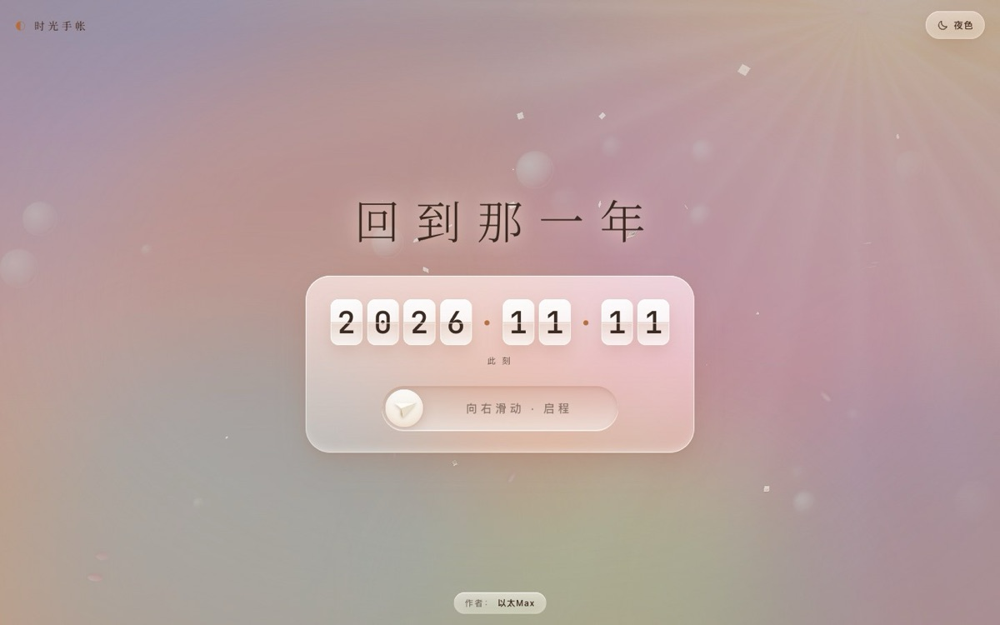
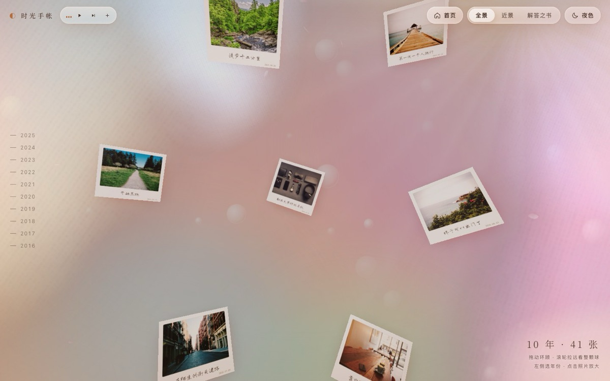
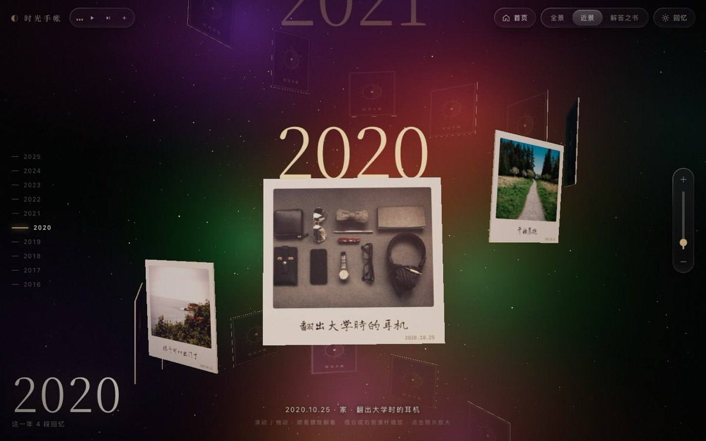
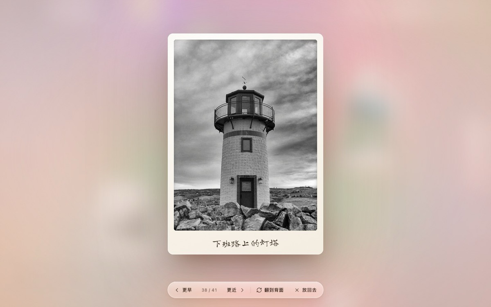
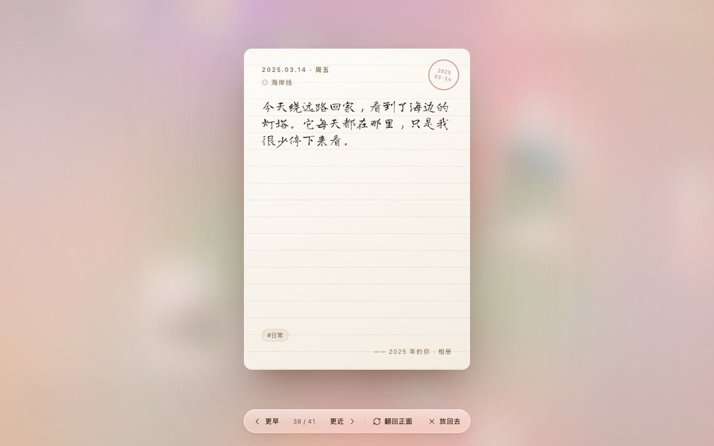
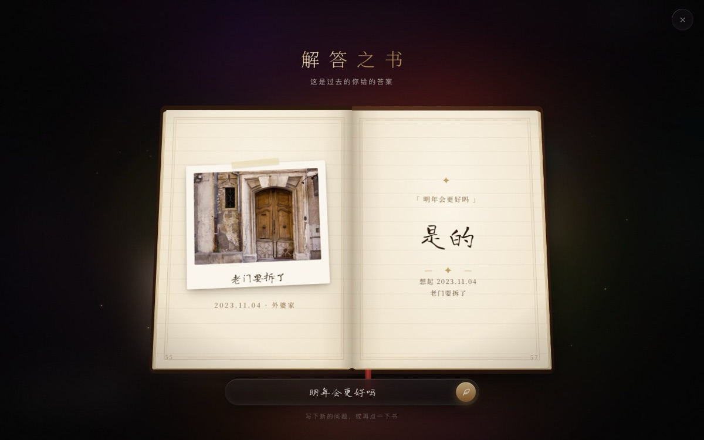
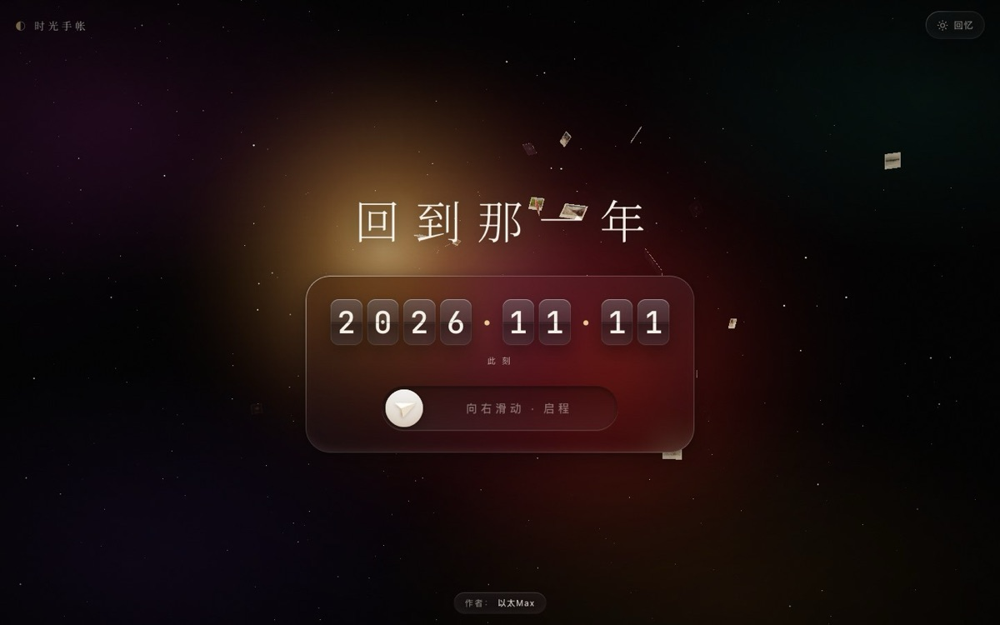

# 时光手帐 · Life Journal

把你自己的照片和旧动态，变成一个可以“穿越回去”翻看的 3D 回忆网页。

这是一个 AI Agent 技能（Skill）：告诉 AI“把我的 QQ 空间做成时光手帐”，它会帮你导出照片、整理成回忆，在本机打开网页；你想分享时，还能帮你发布成一个链接。



> **在线演示**：<https://yt-smart.github.io/life-journal-skill/>（示例照片来自 Unsplash，文案均为虚构）

## 能做什么

- **照片球全景**：所有照片环绕在你四周，拖动环顾，滚轮拉远看整颗球；左侧按年份跳转。
- **螺旋塔近景**：按时间排成一座螺旋塔，滚动翻看每一年。
- **翻到背面**：点开照片看那天写下的话、日期和地点，像翻一张老相片。
- **答案之书**：在心里默念一个问题，翻开它，答案会从你的回忆里出现。带真实的翻书声。
- **两种主题**：回忆（柔和的电影感光影）/ 夜色（五彩斑斓的黑，有流星）。切换时有圆形过渡动画。
- **iOS 玻璃质感界面**，“向右滑动 · 启程”的纸飞机开场，可以放背景音乐。

| | |
|---|---|
|  |  |
|  |  |
|  |  |

## 素材从哪来

| 来源 | 方式 |
|---|---|
| QQ 空间 | 手机 QQ 扫码，导出本人带图的说说；自动去掉“图片已删除”占位图 |
| 微博 | 手机微博扫码，导出本人原创带图微博（补全长文和 9 张以上的图）；也能导入浏览器里保存的数据 |
| 百度网盘 | 通过百度网盘 MCP 连接器检索、看缩略图、取图；或者用客户端下载后导入 |
| 夸克网盘 | 用到时再安装夸克官方技能并授权 |
| 电脑 / 手机相册 | 文件、文件夹、ZIP 都行；读取 EXIF 拍摄时间；iPhone 的 HEIC 自动转 JPEG（macOS）；支持 Google 相册 Takeout |
| 直接给几张图 | 加上一段话，AI 帮你记成一段回忆 |

所有来源都会合并进同一份“回忆数据包”，网页按时间自动排好。**日期不编**：读不到拍摄时间就显示“日期未知”。

## 快速开始

把下面这句话发给你的 AI（Claude Code、豆包等能装技能的 Agent 都行）：

> 安装这个技能 https://github.com/YT-smart/life-journal-skill ，然后用我 QQ 空间的照片帮我做一个时光手帐

照片在别处，就换成你的说法，比如：

- “……用我微博里的照片做一个时光手帐”
- “……用电脑里「旅行」文件夹的照片做一个回忆网页”
- “……先用示例照片给我看看效果”

剩下的交给 AI：需要扫码时它会把二维码发给你，做好后直接在浏览器里打开网页。

## 发布与分享

想发给朋友看时，AI 会先生成一份**分享副本**，并把要分享的内容给你过目：

- 照片去掉 GPS 定位、相机型号等元数据；
- 重新编号，不带说说、微博编号和原文件名；
- 提醒文字里疑似手机号、身份证号、@别人、门牌地址的地方；
- 超过平台上限时自动缩小照片。

确认后按顺序选平台：

1. 在豆包里：用豆包自带的网页发布（50MB）；
2. 其他平台：用宿主自带的发布功能；
3. 没有自带功能或体积太大：用腾讯云 EdgeOne Makers（需要登录腾讯云并完成实名认证）；
4. 想发到飞书：用飞书妙搭。

详见 [references/publishing.md](references/publishing.md)。

## 目录结构

```
SKILL.md              给 AI 的说明（流程、规则）
references/           各来源接入、数据格式、发布、网页玩法的详细说明
scripts/              导入、检查、预览、发布脚本（Python 3 标准库）
assets/site/          3D 回忆网页（index.html + 翻书声）
examples/demo/        示例数据（41 张示例照片 + 虚构文案）
docs/screenshots/     README 截图
index.html            在线演示入口（GitHub Pages）
```

你的项目默认放在 `~/时光手帐/`，不会写进这个文件夹。

## 隐私

- 只读你**自己的**内容；扫码登录在你的手机上确认，脚本拿不到也不需要密码，登录凭证只在内存里，结束即失效。
- 不发帖、不评论、不删除，也不改云端文件。
- 照片只保存在你的电脑上。只有你明确同意并确认范围后，才会发布；发布用的是去掉定位信息的分享副本。

## 开源协议

代码以 [MIT](LICENSE) 协议开源。示例照片不属于本协议，按 [Unsplash License](https://unsplash.com/license) 使用，见 [examples/demo/CREDITS.md](examples/demo/CREDITS.md)。

## 作者

[以太Max](https://v.douyin.com/0CUOBIT0cfU)
